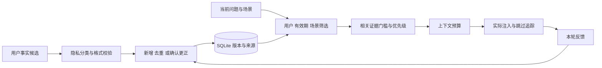

# 小拍的个性化记忆优化

从桌面陪伴 Agent 中独立提取的记忆管理与离线评测实现。核心问题是让持久化偏好在正确的时间、场景和问题中生效，并能解释每次采用或跳过的原因。

本仓库仅包含实现代码、自动化测试和明确虚构的合成评测样例。无需模型密钥、网络、照片或原应用即可运行。公开配置与对话提示词已改成中性示例，不读取任何既有应用目录。

## 实现内容

- **可更正的持久化事实**。用 SQLite 保存用户、属性、场景、有效期、来源消息与版本关系。相同事实去重，明确更正以事务原子更新旧版本和历史记录。
- **按当前情况选择记忆**。V1 先检查用户、时间与场景，再要求相关证据；临时例外和适用的场景偏好优先，证据不足时允许不注入。按条数与字符预算选择上下文。
- **可追溯的反馈**。反馈绑定本轮检索和具体记忆版本。「这次不适用」只记录反馈，明确确认长期更正后才创建新版本。
- **可解释的检索**。记录候选、实际注入、耗时、字符数以及 `expired`、`scene_mismatch`、`insufficient_evidence` 等跳过原因。检索追踪事件本身不携带原始对话文本。
- **可复现的跨会话评测**。固定抽取结果与时钟，每次会话重开 SQLite，两种策略各用独立数据库。覆盖长期更正、临时偏好到期、场景切换、无关问题及用户隔离。



## 快速运行

Python 3.9+，离线部分只使用标准库。在仓库根目录执行。

```bash
python scripts/run_tests.py
python scripts/eval_memory_evolution.py
python scripts/eval_memory_evolution.py --scale 100 --jobs 8 --output .runtime/scale-100x/report.json
```

默认从 `tests/memory_evolution_cases.json` 读取 32 条虚构轨迹。100 倍回放生成 3,200 条轨迹，其中 800 条调试、2,400 条留出，留出集有 3,600 个计分探针。`--dataset-output .runtime/cases.json` 可保存本次生成的语料，`--replay-dir .runtime/replay-db` 可保留隔离回放数据库。运行产物均应留在被忽略的 `.runtime/` 中。

大规模报告由精简摘要及按运行编号隔离的 JSONL 归档组成，支持按指标读取 24 条一页的样本。完整归档仅在运行后本地生成，不随仓库发布。

## 实验结果与取舍

以下为原项目 2026-11-06 的 100 倍合成回放，运行编号 `20261106T090823Z-975bd169`。比较对象是两种检索策略；它们共用 SQLite、显式更正、来源追溯、用户隔离及预算机制。

2026-11-17 在本公共导出版本上重新运行全部 71 项测试及 3,200 条轨迹回放，测试通过、回放错误为 0。新运行 `20261117T114516Z-0dab2bb2` 的以下计数和注入字符均值与原实验一致，仍保留 37 轮新增失败。

| 留出指标 | V0 | V1 |
| --- | ---: | ---: |
| 无需个性化时仍注入偏好 | 600/600（100.0%） | 55/600（9.2%） |
| 更正或到期后注入陈旧偏好 | 1,061/1,200（88.4%） | 319/1,200（26.6%） |
| 完整预期偏好进入上下文 | 3,000/3,000（100.0%） | 2,093/3,000（69.8%） |
| 跨用户误注入 | 0/3,600 | 0/3,600 |
| 每轮平均注入记忆字符 | 31.36 | 11.98 |

V0 在缺少词面匹配时按重要度、时近性兜底，容易把不相关偏好带入提示词。V1 的时间与场景约束以及相关证据门槛减少误注入，但更严格的词法证据也导致漏召回。**完整召回下降 30.2 个百分点**，907 个应入选值均因证据不足被跳过；其中 37 轮从 V0 整轮通过变为 V1 失败。剩余 319 次陈旧误注入都出现在更正轨迹，旧值仍是 active，反映出更正措辞识别的不足。

每轮平均注入字符减少约 61.8%，仅指记忆片段，不代表完整提示词 token、费用或存储条目下降。各行分母按适用场景定义，不能直接互相比较。

数据由模板与虚构设定生成，同一虚构用户的轨迹共享设定。回放采用固定抽取结果、标注场景及词法检索，没有验证自动场景识别、向量召回或真实用户回答质量。公共版本使用中性提示词；复跑耗时会随机器与并发数变化。它是可检查的工程实验，不是线上 A/B 实验。

后续改进方向是补足更正意图识别、用同义或语义证据缓解漏召回，并同时加入同主题但无需个性化的负例。现有失败样本应保留，用独立数据检验修复后的收益与副作用。

## 阅读代码

| 路径 | 职责 |
| --- | --- |
| `src/puppy_agent/models.py` | 结构化记忆候选 |
| `src/puppy_agent/facts.py` | 新增、更新、去重决策 |
| `src/puppy_agent/storage.py` | SQLite 事务、版本历史与索引任务 |
| `src/puppy_agent/memory.py` | 抽取结果校验、隐私分类、更正和反馈 |
| `src/puppy_agent/memory_context.py` | 场景、临时意图与有效期 |
| `src/puppy_agent/retrieval.py` | V0/V1 检索、优先级与预算 |
| `src/puppy_agent/conversation.py` | 上下文组装与异步记忆提取 |
| `src/puppy_agent/recall_trace.py` | 不含原话的检索阶段事件 |
| `src/puppy_runtime/memory_evolution_report.py` | 原子报告发布、索引与分页读取 |
| `scripts/eval_memory_evolution.py` | 确定性离线回放与指标计算 |
| `scripts/memory_evolution_corpus.py` | 合成语料扩充与调试/留出隔离 |

## 公开范围

保留原项目的记忆、检索、持久化与回放算法。为独立运行，替换了应用设置、默认路径和角色提示词，移除了真实模型调用及本机密钥读取，并为无 Git 的源码压缩包提供版本标识回退。测试中的饮品、地点、身份与敏感内容是用于验证分类和隔离规则的虚构输入，不是导出的用户档案。

仓库不包含原应用历史、用户数据库、对话记录、运行日志、密钥、照片、角色模型、桌面 UI 或简历。检索器保留外部向量索引的接口，但本导出不带 Chroma / 嵌入服务适配器，以上实验也未启用该接口。
